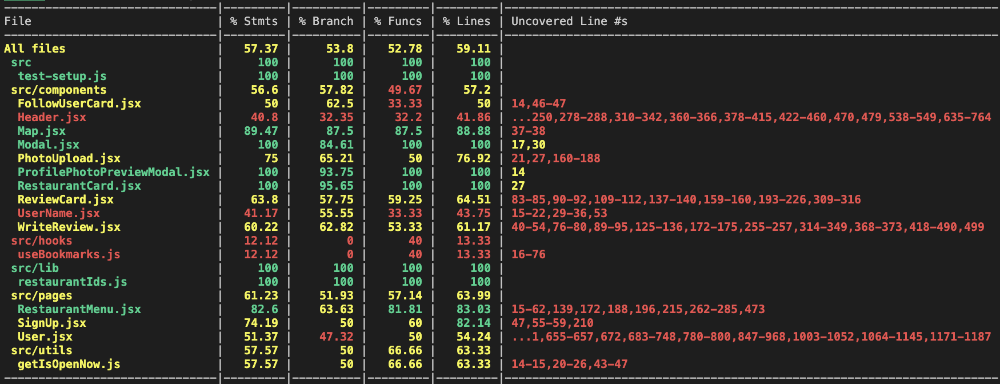
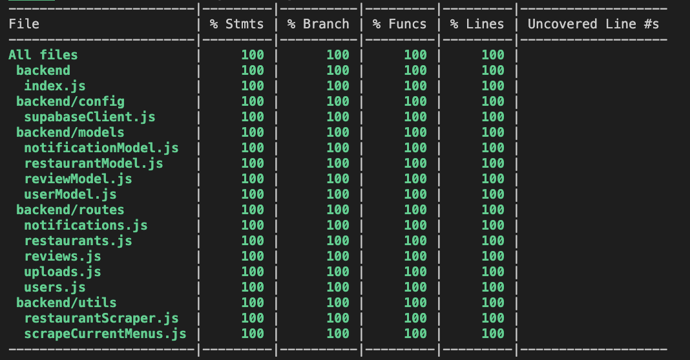

# UMami

## Project Documents

- [Tech Spec](https://docs.google.com/document/d/1biFBA__u-CT9FaSdJ9TKkr0FtEnpOxAQAJ2IcFMF8Ec/edit?tab=t.0)
- [Presentation](https://docs.google.com/presentation/d/1GdwA16oiCBMre5I_dxVai33FX3x5VDIYP7rzQ17KHrA/edit?slide=id.p1#slide=id.p1)
- [Video Demo](https://youtu.be/DkY0ubg_JFQ)

## Deployment

### Live App

🌐 [UMami](https://umami.elischiffler.dev)

[Backend API](https://api.umami.elischiffler.dev)

The current application is maintained in the
[personal repository](https://github.com/elischiffler/UMami).
Azure retirement is pending deployment and public verification.
This repository preserves the historical application and publishes only
the isolated retirement artifacts through manually approved workflows.
See [the retirement runbook](docs/azure-retirement.md) and
[validation evidence](docs/validation.md).

### CI/CD Status

[](https://github.com/Calpoly-Yelp/UMami/actions/workflows/ci-testing.yml)

[](https://github.com/Calpoly-Yelp/UMami/actions/workflows/cypress.yml)

## Running Testing:

```console
npm run test
npm run frontend:test
npm run backend:test
```

## Running Test Coverage & Updating README:

```console
npm run test:coverage
node update-coverage.js
```

## Running Prettier:

```console
npm run format
```

## Running Linter

```console
npm run lint
npm run lint:fix
```

## Running Frontend

```console
npm run frontend:dev
```

## Running Backend

```console
npm run backend:dev
```

## Running Frontend+Backend

```console
npm run dev
```

## Formatting + Linting (Using Prettier and ESLint)

### One-time setup

1. Install dependencies from the repo root:
   - `npm install`
   - `npm --prefix frontend install`
   - `npm --prefix backend install`

2. Install VS Code extensions:
   - **ESLint** (dbaeumer.vscode-eslint)
   - **Prettier – Code formatter** (esbenp.prettier-vscode)

3. VS Code will use the repo’s `.vscode/settings.json` to:
   - format on save (Prettier)
   - auto-fix lint issues on save (ESLint)

## Code Coverage

<!-- Screenshot of Terminal Test Coverage -->




<!-- COVERAGE-START -->

| Project  | Lines  | Statements | Functions | Branches |
| :------- | :----: | :--------: | :-------: | :------: |
| Frontend | 59.11% |   57.37%   |  52.78%   |  53.8%   |
| Backend  |  100%  |    100%    |   100%    |   100%   |

<!-- COVERAGE-END -->
